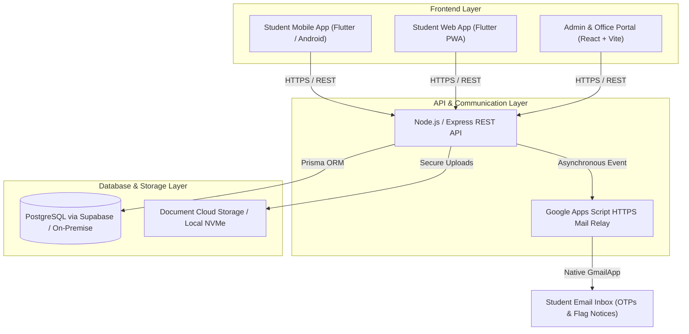
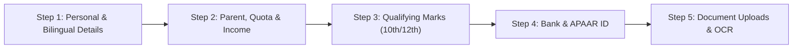
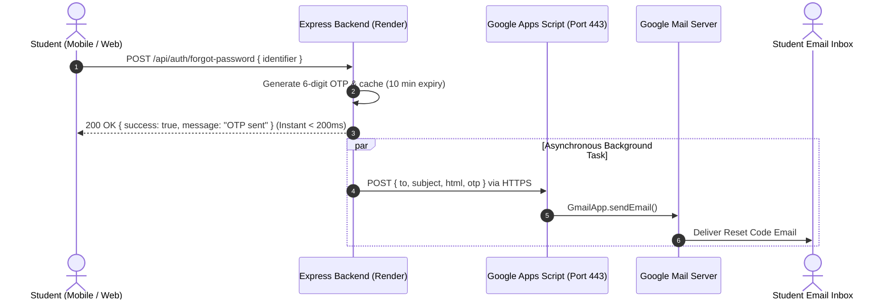
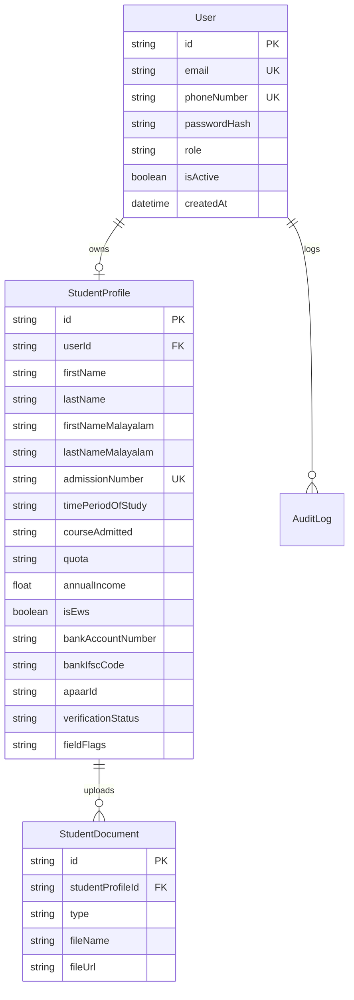

# Baselios Poulose II Catholicose College (BPC Piravom)
## Student Digital Admission, Verification & Identity Platform
### Comprehensive System Architecture & Engineering Documentation

---

## 1. Executive Summary

The **BPC Student Admission & Document Verification Platform** is an enterprise-grade academic management system designed specifically for **Baselios Poulose II Catholicose College, Piravom**. 

The system transitions the traditional, paper-heavy college admission and certificate verification process into a unified, secure, paperless digital pipeline. It connects three primary stakeholders:
1. **Prospective & Enrolled Students**: Use the mobile app (or web app) to register, complete their bilingual admission profile, upload certificates, view their digital student ID card, and track verification stages in real time.
2. **College Office Clerks**: Audit uploaded certificates against student-entered records in a split-screen workspace, utilizing OCR extraction rules and an inline flagging system to request corrections.
3. **Principal & Institutional Authorities**: Review verified batches, grant final institutional enrollment approval, and generate permanent college register entries.



---

## 2. Technology Stack Overview

| Tier | Technology | Purpose |
| :--- | :--- | :--- |
| **Mobile & Student Web** | **Flutter 3.x (Dart 3)** | Cross-platform student app (Android APK + Web PWA) with bilingual Malayalam/English rendering. |
| **Admin & Office Web** | **React 18 + Vite + Tailwind CSS** | High-productivity split-screen document audit console with OCR extraction rules. |
| **Backend API** | **Node.js + Express + TypeScript** | Type-safe REST API with JWT authentication, role guards, and async email dispatch. |
| **Database & ORM** | **PostgreSQL + Prisma ORM** | Relational schema with cascading deletes, JSON field flags, and audit tracking. |
| **Email Relay** | **Google Apps Script (Port 443 HTTPS)** | Serverless relay bypassing cloud SMTP port blocks to deliver OTPs and flag alerts via Gmail. |
| **Document Processing** | **Custom OCR Extraction Engine** | RegEx and heuristic rules engine for SSLC, Plus Two, Income, Caste, and APAAR documents. |

---

## 3. Student Mobile Application (Flutter)

The student client (`mobile/lib`) is built with Flutter to provide a native, responsive experience.

### 3.1. Dynamic Semester Calculation Engine
Rather than storing static semester numbers that become outdated, the app dynamically calculates the active semester from the student's registered `timePeriodOfStudy` (e.g. `2024–2028`):

* **Academic Year Cycle**: Modeled on the Indian collegiate calendar (June through May).
  $$\text{Academic Year Index} = \text{Current Year} - \text{Start Year} - (\text{Current Month} < 6 ? 1 : 0)$$
* **Semester within Year**:
  $$\text{Sem in Year} = (\text{Current Month} \ge 6 \land \text{Current Month} \le 11) ? 1 : 2$$
* **Final Semester**:
  $$\text{Active Semester} = (\text{Academic Year Index} \times 2) + \text{Sem in Year}$$
* *Example*: In November 2026 for a student enrolled for `2024–2028`:
  $$\text{Index} = 2026 - 2024 = 2 \implies \text{Semester} = (2 \times 2) + 1 = \mathbf{5}\ (\text{Semester 5})$$

### 3.2. Digital Student Identity Card
* **Bilingual Display**: Displays the student's legal name in English alongside native Malayalam script (e.g., `HARISANTH S / ഹരിശാന്ത് എസ്`).
* **Dynamic Verification Status Badge**:
  * `VERIFIED` (Emerald Green): Fully approved by office and Principal.
  * `SUBMITTED` (Blue): Under review by college administration.
  * `ACTION NEEDED` (Amber Gold): One or more documents/fields require student correction.
* **Campus Gate Pass**: Generates dynamic QR code (`qr_flutter`) containing cryptographically verifiable student metadata for campus entry and library borrowing.

### 3.3. 5-Step Admission Pipeline

1. **Personal Information**: Name, bilingual Malayalam name, date of birth, blood group, contact address.
2. **Quota & Income**: Reservation category (Merit, Management, Sports, Community), religion, caste, annual family income. Includes automatic **EWS eligibility calculation** (income $< \text{₹}1,00,000$).
3. **Qualifying Academic History**: 10th (SSLC) and 12th (Plus Two/CBSE/ICSE) marks, roll numbers, board, passing percentage.
4. **Financial & National IDs**: Bank account details (Account number, bank name, branch, IFSC code) and Government APAAR / ABC ID.
5. **Certificate Repository**: PDF and image uploads (`PROFILE_PHOTO`, `SSLC_CERTIFICATE`, `PLUS_TWO_CERTIFICATE`, `ALLOTMENT_MEMO`, `INCOME_CERTIFICATE`, `CASTE_CERTIFICATE`, `BANK_PASSBOOK`, `APAAR_DOCUMENT`).

### 3.4. Real-Time "Action Needed" Correction System
When a clerk flags an error in the student's profile:
* The student app home screen displays a high-priority yellow alert banner: *"Action Needed: Correction Required"*.
* Tapping **Resolve Clarification** opens an interactive sheet showing the exact clerk feedback and allowing instant re-upload of the rejected document.

---

## 4. Admin & Office Verification Portal (React + Vite)

The admin portal (`web/src`) is tailored for college office staff, Head of Departments (HOD), and the Principal.

### 4.1. Split-Screen Document Verification
* **Left Panel**: Clean, structured view of student-entered personal, academic, and banking information.
* **Right Panel**: Embedded, high-resolution document viewer for original certificates with zoom, rotation, and side-by-side comparison.

### 4.2. Granular Field Flagging & Correction Dispatch
Instead of outright rejecting an entire admission, clerks can flag individual fields:
* Flagged status: `FLAGGED_ERROR`
* Custom clerk comment: e.g. *"SSLC mark card blurred. Please upload clear scan showing register number."*
* Clicking **"Submit Audit Review"** updates the database and immediately dispatches an automated notification email to the student with the exact instructions.

### 4.3. Multi-Tier Institutional Approval
```
[Student Submission] ──► [Office Clerk Verification] ──► [Principal Approval] ──► [Permanent ERP Enrollment]
```

---

## 5. Backend Engine & Email Infrastructure

The backend (`backend/src`) is built with Express, TypeScript, and Prisma.

### 5.1. Non-Blocking Async Architecture
To prevent mobile devices from hitting 30-second socket aborts (`ClientSoftware caused connection abort`), time-consuming operations (such as sending emails) are decoupled from API HTTP responses:
* **Forgot Password Route (`/api/auth/forgot-password`)**: Generates the 6-digit OTP, stores it in memory with an expiration timestamp, and replies to the client in **$< 200\text{ ms}$**.
* Email transmission runs asynchronously in the background via event handlers.

### 5.2. Cloudflare / Render HTTPS Email Relay
Traditional SMTP (ports `25`, `465`, `587`) is blocked on most cloud free tiers (including Render) to prevent spam. 

The system uses a custom **Google Apps Script HTTPS Webhook Relay** running on standard **Port 443**:
1. Render backend issues an HTTPS `POST` to `https://script.google.com/macros/s/.../exec`.
2. The Google Web App executes `GmailApp.sendEmail()` natively inside Google Cloud from the college account (`harisanths56@gmail.com`).
3. Students receive authentic, non-spam OTPs and notifications within 1–2 seconds.



---

## 6. Database Schema (Prisma / PostgreSQL)



---

## 7. Future On-Premise College Server Deployment

When the college deploys this system onto a local server in the computer lab or server room, the architecture transitions to a self-contained **Docker Compose** environment:

```
[ College Campus Server (Ubuntu Server / Windows) ]
 │
 ├── [ Nginx Reverse Proxy (Ports 80/443) ]
 │    ├── /admin  ──► [ Admin React Portal Build ]
 │    ├── /api    ──► [ Node.js Express API Container ]
 │    └── /       ──► [ Student Flutter Web App (PWA) ]
 │
 ├── [ PostgreSQL 16 Container ] (Replaces external cloud database)
 └── [ Cloudflare Tunnel Daemon (`cloudflared`) ] (Secure public HTTPS without static IP)
```

### Advantages of the College Server Setup:
1. **Zero Recurring Hosting Costs**: Runs entirely on college electricity and internet.
2. **No Static IP or Open Router Ports Needed**: The Cloudflare Tunnel connects outbound over HTTPS, providing free SSL certificates (`https://portal.bpccollege.ac.in`) and DDoS protection.
3. **Data Sovereignty**: Student certificates, bank details, and personal records remain strictly on college property.
4. **Universal Web Access**: Students can access the portal from laptops, iPhones, and Android devices via browser, or install it as a desktop/mobile PWA.

---

*Authored for Baselios Poulose II Catholicose College, Piravom.*
